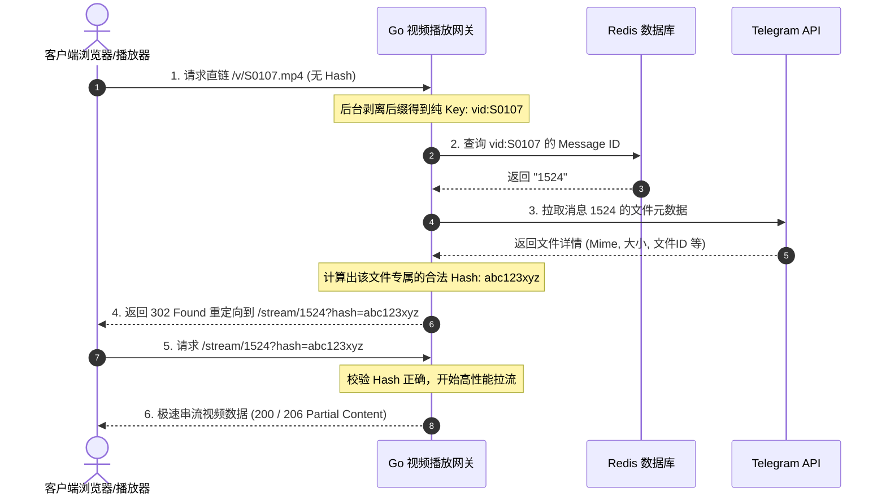

# TG-FileStreamBot 改造更新日志

## 2026-05-18 - 新增自定义 title 下载重命名与 Attachment 强制下载功能

本次更新为大文件流式和图片媒体响应新增了 `title` 自定义下载名称的支持，并且在 `/v/:filename` 文件名直链路由中完美支持了参数透传。当接收到 `title` 参数时，接口会自动将响应包装为 `attachment` 下载模式，并采用传入的 `title` 加上正确的原文件后缀名作为下载文件名，同时对不安全字符进行了过滤净化。

---

### 🛠️ 改造工作总结

1. **自定义 `title` 下载与强转 Attachment 下载**
   - **参数解析**：提取 `title := ctx.Query("title")` 参数。
   - **重命名与后缀追加**：获取原文件的正确后缀名 `ext := filepath.Ext(file.FileName)`（如 `.mp4`, `.png` 等），若传入的 `title` 中尚未包含该后缀，则在尾部自动拼装，确保文件能被本地播放器或阅读器正确识别并打开。
   - **安全参数过滤（防注入）**：为防止 HTTP 头注入（Header Injection）或因特殊字符导致浏览器崩溃，自动对 `title` 中的双引号 `"` 替换为下划线 `_`，并过滤掉回车换行符 `\r` 和 `\n`。
   - **强转附件下载**：只要传入 `title` 参数，不论原请求是否有 `?d=true`，均会自动将 `Content-Disposition` 设为 `attachment` 下载模式。

2. **多响应端点完美适配**
   - 改造逻辑同时适配了**视频/大文件流媒体串流响应**（`/stream/:messageID`）以及**图片小媒体响应**（`file.FileSize == 0` 的情况），在两个分支中统一支持 `title` 参数，体验极佳。

3. **重定向路由无损参数透传**
   - 升级 `/v/:filename` 直链路由（`StreamByFileName`），通过内部获取 `c.Request.URL.Query()`，将外部传入的所有 Query 参数（包含 `title`、`d` 等自定义下载参数）以及动态生成的 `hash` 校验码完美组合，优雅重定向至 `/stream/:messageID?...`，实现链路无损透传。

---

### 🚀 效果与接口流程展示

#### 请求流程示例：
* **不带 title 默认播放/预览**：
  `http://127.0.0.1:8080/v/S0107.mp4` -> 302重定向 -> 默认行内播放（inline）。
* **带 title 强制触发重命名下载**：
  `http://127.0.0.1:8080/v/S0107.mp4?title=亮剑第一集` -> 302重定向至 `/stream/1524?hash=xxx&title=亮剑第一集` -> 浏览器弹出下载窗口，下载文件名为 `亮剑第一集.mp4`，响应模式为 `attachment`。
* **带后缀的 title 下载**：
  `http://127.0.0.1:8080/v/S0107.mp4?title=亮剑第一集.mp4` -> 同样触发下载，下载文件名为 `亮剑第一集.mp4`，不会重复追加后缀（如 `.mp4.mp4`）。

---

## 2026-05-18 - 基于 Redis 的文件名无感安全重定向路由改造

本次改造在完全保留并维护项目原生 `/stream/:messageID` 接口的安全哈希校验（Hash Validation）的前提下，新增了基于 Redis 文件名路由的 `/v/:filename` 直链端点，并在后台实现自动提取后缀、获取 Telegram 消息、动态计算 Hash 及 302 重定向。

---

### 🛠️ 改造工作总结

1. **引入 Go-Redis 客户端依赖**
   - 在项目根目录下成功添加并拉取了 Go Redis 官方客户端依赖库 `github.com/redis/go-redis/v9`。

2. **保留并还原原生 Hash 鉴权校验（安全性设计）**
   * 修改文件：[stream.go](internal/routes/stream.go)
   * 功能：在 `getStreamRoute` 中完全保留/恢复了原生的 `hash` 鉴权与校验逻辑。所有外部针对原生流媒体接口 `/stream/:messageID` 的直连请求，若无正确 `?hash=` 参数都将被安全拦截并返回 `400 Bad Request`，保障了防爬防猜测的安全机制。

3. **新增智能文件名路由与动态 Hash 重定向**
   * 修改文件：[stream.go](internal/routes/stream.go)
   * 路由：在 `LoadHome` 方法中注册了专属的 `/v/:filename` 访问路由。
   * 实现逻辑：
     1. **后缀剥离与兼容**：获取 URL 参数 `:filename`（如 `S0107.mp4` 或 `S0107`），通过 `filepath.Ext` 动态去除任何文件后缀，得到纯视频编号 `S0107`。
     2. **Redis 映射检索**：在 Redis 中查询 `vid:S0107`，以 O(1) 的超高效率获取对应的 Telegram Message ID。
     3. **动态计算安全 Hash**：在服务端内部，获取该 Message ID 对应的 Telegram 文件元数据（`FileName`, `FileSize`, `MimeType`, `ID`），动态为该文件计算出绝对正确且合法的 Short Hash。
     4. **302 自动重定向**：将客户端通过 `302 Found` 优雅且无感地重定向至包含正确 Hash 的原生播放地址 `/stream/:messageID?hash=xxx`，实现无缝拉流播放。

---

### 🚀 效果与接口流程展示

#### 请求流程示例：
* **公开直链**：`http://127.0.0.1:8080/v/S0107.mp4` (或不带后缀 `http://127.0.0.1:8080/v/S0107`)
* **Redis 解析与计算**：根据 `vid:S0107` 提取到 `messageID` = `1524`，后台算出有效哈希 `hash` = `abc123xyz`。
* **重定向结果**：自动重定向至安全直链 `http://127.0.0.1:8080/stream/1524?hash=abc123xyz` 并瞬间起播。
